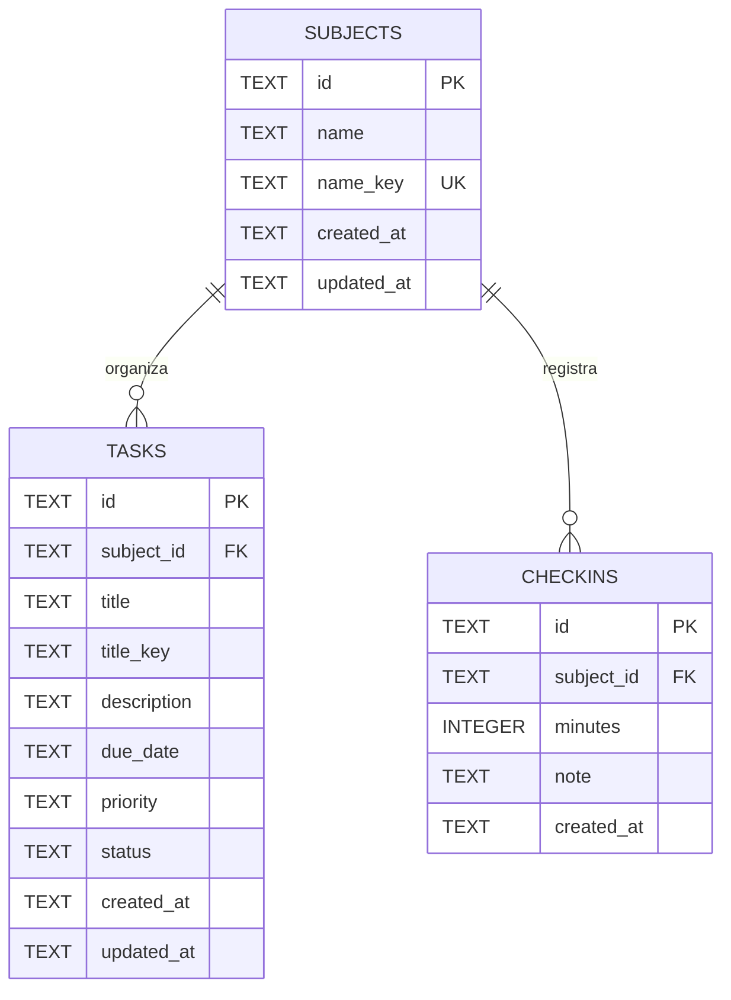

# Modelo do banco StudyFlow

## Escolha

SQLite é um banco relacional armazenado em arquivo. Atende aos vínculos naturais entre matérias, tarefas e sessões de estudo, sem exigir instalação ou administração de um serviço de banco separado. O projeto usa `DatabaseSync` de `node:sqlite`, disponível no Node.js 24 adotado nesta etapa, sem adicionar um driver npm.

PostgreSQL/MySQL também atenderiam ao modelo, mas exigiriam um servidor e configuração adicionais para esta apresentação. MongoDB não oferece vantagem para os relacionamentos e restrições simples do domínio. SQLite permite demonstrar SQL, transações, integridade e persistência de forma reproduzível.

## Modelo conceitual

Versão visual: [modelo.svg](modelo.svg).

## Modelo lógico

### subjects — matérias

Finalidade: catálogo de disciplinas compartilhado pela API.

| Coluna | Tipo SQLite | Obrigatória | Restrição/finalidade |
| --- | --- | --- | --- |
| id | TEXT | Sim | PK, UUID gerado pelo servidor; formato validado no backend. |
| name | TEXT | Sim | Nome normalizado com 1 a 60 caracteres. |
| name_key | TEXT | Sim | UNIQUE; chave NFC/minúscula para comparação e duplicidade. |
| created_at | TEXT | Sim | Timestamp ISO de criação. |
| updated_at | TEXT | Não | Timestamp da última alteração. |

`name_key` é interno e não é aceito do cliente nem exposto como campo editável.

### tasks — tarefas

Finalidade: atividades acadêmicas com prazo, prioridade e status.

| Coluna | Tipo SQLite | Obrigatória | Restrição/finalidade |
| --- | --- | --- | --- |
| id | TEXT | Sim | PK, UUID. |
| subject_id | TEXT | Sim | FK para subjects.id, ON DELETE RESTRICT. |
| title | TEXT | Sim | 3 a 100 caracteres. |
| title_key | TEXT | Sim | Chave normalizada interna para duplicidade. |
| description | TEXT | Sim | Até 500 caracteres; padrão vazio. |
| due_date | TEXT | Sim | YYYY-MM-DD e data real por CHECK; prazo passado é rejeitado pelo service ao criar/alterar a data. |
| priority | TEXT | Sim | CHECK: alta, media ou baixa. |
| status | TEXT | Sim | CHECK: pendente ou concluida. |
| created_at | TEXT | Sim | Timestamp ISO. |
| updated_at | TEXT | Não | Timestamp de atualização. |

Há UNIQUE composto em `(title_key, subject_id, due_date)`. Uma tarefa de mesmo título, matéria e prazo não pode ser duplicada. `subject_id` tem índice para consultas e integridade referencial.

### checkins — sessões de estudo

Finalidade: registrar o tempo estudado em uma matéria, preservando a funcionalidade da Etapa 05.

| Coluna | Tipo SQLite | Obrigatória | Restrição/finalidade |
| --- | --- | --- | --- |
| id | TEXT | Sim | PK, UUID. |
| subject_id | TEXT | Sim | FK para subjects.id, ON DELETE RESTRICT. |
| minutes | INTEGER | Sim | CHECK entre 1 e 600; STRICT impede frações. |
| note | TEXT | Sim | Até 180 caracteres; padrão vazio. |
| created_at | TEXT | Sim | Timestamp ISO. |

O histórico é ordenado do mais recente para o mais antigo. O CRUD completo é implementado para matérias e tarefas; os check-ins preservam as operações GET/POST existentes.

### Tabelas técnicas

`schema_migrations(version INTEGER PRIMARY KEY, applied_at TEXT NOT NULL)` registra as migrações aplicadas. `seed_runs(name TEXT PRIMARY KEY, applied_at TEXT NOT NULL)` registra o seed demonstrativo. Não são entidades de negócio nem endpoints públicos.

## Relacionamentos e integridade

- Uma matéria tem zero ou muitas tarefas; cada tarefa pertence a exatamente uma matéria.
- Uma matéria tem zero ou muitos check-ins; cada check-in pertence a exatamente uma matéria.
- `PRAGMA foreign_keys = ON` é aplicado a cada conexão.
- A exclusão da matéria é bloqueada se houver tarefas **ou** check-ins vinculados. O service informa HTTP 409 e a FK também impede a exclusão diretamente no banco.
- Renomear uma matéria mantém seu UUID; as consultas JOIN retornam o novo nome nas tarefas e no histórico, sem copiar nomes para múltiplas tabelas.
- Não há exclusão em cascata: remover uma matéria não deve apagar atividades acadêmicas silenciosamente.

## SQL e migrações

O SQL completo e executado pela aplicação está em [`backend/src/database/migrations/001-initial.sql`](../../backend/src/database/migrations/001-initial.sql). Esse é o esquema canônico, incluindo PK, FK, NOT NULL, UNIQUE, CHECK, STRICT e índices.

`connection.js` aplica somente migrações ainda não registradas, dentro de `BEGIN IMMEDIATE`/`COMMIT`, com `ROLLBACK` em falha. A inicialização normal não apaga tabelas nem insere novamente os exemplos. O seed é opcional, transacional e marcado uma única vez.

## Banco físico e API

Padrão: `backend/data/studyflow.sqlite`. `DATABASE_PATH` permite escolher outro arquivo. O arquivo, journals e `.env` ficam fora do Git. O esquema e o seed reproduzem o banco sem distribuir dados pessoais.

As respostas mantêm camelCase: `subjectId`, `dueDate`, `createdAt`, `updatedAt`. Os repositories traduzem essas propriedades para as colunas SQL e preservam o campo textual `subject` das etapas anteriores através de JOIN.

O cliente pode informar `subjectId` ou o nome `subject` de uma matéria **já cadastrada**. Se ambos forem enviados, devem apontar para a mesma matéria. A API não cria uma disciplina implicitamente ao receber uma tarefa.

Referências: [SQLite no Node.js](https://nodejs.org/download/release/latest-v24.x/docs/api/sqlite.html) e [chaves estrangeiras no SQLite](https://www.sqlite.org/foreignkeys.html).
