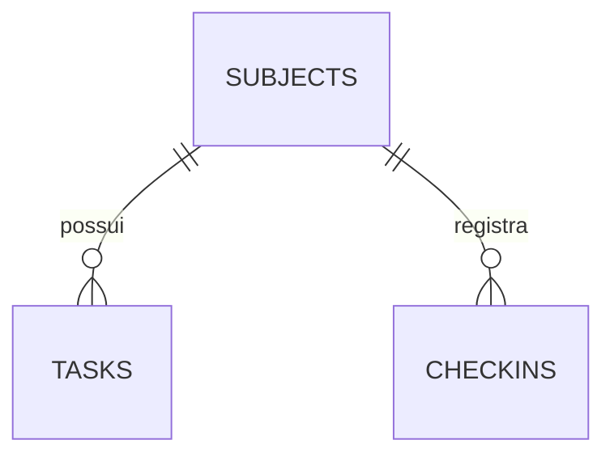

# StudyFlow — Etapa 07 Persistência e CRUD com banco de dados

## 1. Objetivo e diagnóstico

Esta etapa substitui a fonte temporária da API por SQLite em arquivo. Matérias, tarefas e check-ins continuam armazenados ao fechar o navegador ou reiniciar o backend.

O diagnóstico da Etapa 06 identificou cinco páginas HTML, CSS responsivo e ES Modules no front-end. O Express já separava rotas, controllers e services, mas `backend/src/data/store.js` mantinha tarefas e check-ins em arrays; matérias eram locais ao navegador. Esses arrays foram removidos como fonte principal, e matérias passaram a ser uma entidade da API.

A implementação foi conferida com o documento oficial **ETAPA 07 — PERSISTÊNCIA E CRUD COM BANCO DE DADOS**. A entrega inclui código, modelo, descrição das entidades e relacionamentos, instruções de criação do banco e exemplos de CRUD.

## 2. Banco escolhido

**SQLite, relacional, em arquivo.** O domínio tem relacionamentos naturais de uma matéria para várias tarefas e vários check-ins. SQLite oferece chaves estrangeiras, transações e restrições em uma instalação simples, sem serviço adicional de banco.

Foi preferido a PostgreSQL/MySQL para reduzir a configuração da apresentação acadêmica. Não havia outro banco a preservar. O modelo relacional também é direto para este domínio, sem necessidade de uma solução NoSQL. O acesso usa `node:sqlite` do Node.js 24; a dependência Express continua fixada no lockfile.

O arquivo padrão é `backend/data/studyflow.sqlite`. O banco não é apagado nem recriado ao iniciar a API. Não há fallback silencioso para arrays ou armazenamento local quando uma operação do banco falha.

## 3. Modelo e relacionamentos

O modelo completo, com tipos, atributos e restrições, está em [banco/modelo.md](banco/modelo.md). A versão visual está em [banco/modelo.svg](banco/modelo.svg). O SQL executável e canônico está em [001-initial.sql](../backend/src/database/migrations/001-initial.sql).



| Entidade | Finalidade | Identificador | Restrições principais |
| --- | --- | --- | --- |
| subjects | Disciplinas do semestre. | UUID textual, PK. | Nome obrigatório de 1–60 caracteres; chave normalizada UNIQUE. |
| tasks | Atividades acadêmicas e prazos. | UUID textual, PK. | FK para matéria; título 3–100; descrição até 500; data real; enums; UNIQUE título/matéria/data. |
| checkins | Sessões de estudo. | UUID textual, PK. | FK para matéria; minutos inteiros de 1–600; observação até 180. |

Cardinalidade: cada tarefa/check-in pertence a exatamente uma matéria; uma matéria pode ter zero ou muitos registros. `ON DELETE RESTRICT` impede a exclusão da matéria em uso, tanto no service quanto diretamente no banco. A API retorna 409, sem apagar as tarefas ou o histórico silenciosamente.

Renomear uma matéria mantém seu ID. As consultas JOIN retornam o novo nome nas tarefas e no histórico. Os campos `name_key` e `title_key` são internos, normalizados em NFC/minúsculas, para comparação de duplicidade sem depender do NOCASE ASCII do SQLite.

## 4. Arquitetura e arquivos

```text
routes → controllers → services → repositories → SQLite
                           ↓
                     regras e validação
```

| Arquivo | Responsabilidade |
| --- | --- |
| `backend/src/database/connection.js` | Caminho, conexão, foreign_keys, busy_timeout, migração versionada e transação. |
| `backend/src/database/migrations/001-initial.sql` | Tabelas STRICT, PK, FK, NOT NULL, UNIQUE, CHECK e índices. |
| `backend/src/database/seeds/demo.js` | Exemplos opcionais inseridos uma única vez, com transação. |
| `backend/src/database/cli.js` | Comandos init, seed e check realmente implementados. |
| `backend/src/repositories/subject.repository.js` | SQL parametrizado das matérias e consulta de dependências. |
| `backend/src/repositories/task.repository.js` | CRUD SQL, JOIN e consulta de duplicidade das tarefas. |
| `backend/src/repositories/checkin.repository.js` | Consulta e inclusão persistente do histórico. |
| `backend/src/services/task.service.js` | Regras de tarefa, existência e relação com matéria. |
| `backend/src/services/subject.service.js` | Validação, duplicidade, renomeação e exclusão protegida de matérias. |
| `backend/src/services/study.service.js` | Recomendações preservadas e check-ins persistidos. |
| `backend/src/controllers/subject.controller.js` | Contrato HTTP de matérias; controller de tarefas foi preservado. |
| `backend/src/routes/subject.routes.js` | Cinco endpoints CRUD de matérias. |
| `backend/src/routes/task.routes.js`, `study.routes.js` | Rotas existentes mantidas, agora recebendo services. |
| `backend/src/app.js`, `server.js` | Composição dos módulos, abertura/fechamento do banco e servidor. |
| `backend/src/validation.js`, `errors.js` | Validação de campos/referências e erros HTTP/persistência. |
| `backend/.env.example`, `package.json`, `package-lock.json` | Configuração sem segredos, scripts e dependências reproduzíveis. |
| `src/assets/js/services/subject-service.js`, `subjects.js` | Fetch e interface de matérias, incluindo renomear e erros de integridade. |
| `src/assets/js/main.js`, `tasks/controller.js` | Inicialização aguarda as matérias; alterações atualizam a interface. |
| `src/assets/js/core/data-mode.js`, `src/*.html`, CSS compartilhado | Fonte de dados informada corretamente, versões e responsividade. |
| `backend/test/` | Regressão da API, banco, relacionamentos, falhas e reinício real. |
| `backend/scripts/persistence-scenario.js`, `record-stage07.js` | Três processos reais e relatório de evidências. |

Não há SQL nas rotas. Services recebem repositories; o banco pode ser substituído sem reescrever os controllers HTTP. O antigo `data/store.js` foi removido. Arrays continuam apenas como resultados de consultas, processamento e fixtures de teste/seed.

## 5. Criação e execução do banco

Pré-requisitos: **Node.js 24 ou superior com npm** e Git para clonar o projeto. Não é necessário instalar SQLite CLI, PostgreSQL, MySQL ou um driver nativo npm.

Na raiz do repositório:

```bash
cd backend
npm ci
npm run db:init
npm run db:seed
npm run db:check
npm start
```

- `db:init` cria o diretório/arquivo se necessário e aplica migrações pendentes.
- `db:seed` é **opcional**: insere três matérias e seis tarefas de demonstração. Só é aplicado uma vez; executar novamente não duplica registros nem restaura tarefas excluídas.
- `db:check` consulta `PRAGMA integrity_check`, `foreign_key_check` e totais das tabelas.
- `npm start` também aplica migrações pendentes, mas **não executa o seed** nem apaga dados.

Abra **http://127.0.0.1:3000/**. O Express entrega front-end e API na mesma origem, dispensando um segundo terminal. `npm run dev` reinicia o processo ao mudar código e mantém o banco.

O banco pode começar vazio: cadastre uma matéria na aba Matérias e depois uma tarefa. As seis tarefas do seed são exemplos identificáveis, não registros obrigatórios para a aplicação.

### Configuração

Se necessário, copie `backend/.env.example` para `backend/.env`. Os scripts start/dev/db carregam esse arquivo opcional com o suporte nativo do Node. Variáveis já definidas no ambiente têm precedência.

```dotenv
PORT=3000
HOST=127.0.0.1
DATABASE_PATH=./data/studyflow.sqlite
CORS_ORIGINS=
```

O caminho padrão, quando DATABASE_PATH não é definido, é absoluto em relação ao módulo do backend. Um caminho relativo personalizado é resolvido a partir da pasta de execução; execute os comandos dentro de `backend` ou use caminho absoluto.

Se uma interface estiver em outra origem, CORS mantém a lista exata configurável da Etapa 06. Não há liberação com `*`. O modo padrão usa a mesma origem.

### Migrações e segurança dos dados

`schema_migrations` registra as versões aplicadas; a migração e o seed usam BEGIN IMMEDIATE, COMMIT e ROLLBACK. `seed_runs` impede reaplicar os exemplos após excluí-los. Não existe comando de reset automático.

O banco local, journals e `.env` estão ignorados no Git. A entrega distribui o esquema e seed, não dados particulares. Para backup simples, pare o servidor e copie o arquivo SQLite para um local seguro. Guarde essa cópia antes de alterações futuras de esquema.

## 6. Endpoints e compatibilidade

| Método | Endpoint | Operação | Sucesso |
| --- | --- | --- | --- |
| GET | `/api/tarefas` | Consulta o banco, incluindo `[]`. | 200 |
| GET | `/api/tarefas/:id` | Consulta individual com JOIN da matéria. | 200 |
| POST | `/api/tarefas` | Insere tarefa relacionada. | 201 + Location |
| PATCH | `/api/tarefas/:id` | Atualiza campos enviados. | 200 |
| DELETE | `/api/tarefas/:id` | Remove tarefa. | 204 |
| GET | `/api/materias` | Lista matérias persistidas. | 200 |
| GET | `/api/materias/:id` | Consulta matéria por UUID. | 200 |
| POST | `/api/materias` | Cria matéria. | 201 + Location |
| PATCH | `/api/materias/:id` | Renomeia matéria. | 200 |
| DELETE | `/api/materias/:id` | Remove somente se não houver vínculos. | 204 |
| GET | `/api/checkins` | Histórico no banco. | 200 |
| POST | `/api/checkins` | Insere sessão de estudo vinculada. | 201 |
| GET | `/api/recomendacoes` | Recomendações estáticas preservadas da Etapa 05. | 200 |

Todos os IDs são UUIDs textuais. As respostas anteriores das tarefas foram preservadas, com `subjectId` e `updatedAt` também disponíveis. O nome `subject` continua retornando texto legível.

`POST/PATCH /api/materias` recebe `{ "name": "Cálculo I" }`. Na criação/atualização de tarefa e criação de check-in, envie **subjectId** ou **subject** de matéria existente. Se enviar ambos, precisam corresponder. Não é criada matéria implicitamente a partir de um nome desconhecido.

O CRUD de tarefas e matérias é completo. Check-ins mantêm GET/POST; não foi acrescentada exclusão do histórico apenas para satisfazer um requisito já cumprido pelos recursos principais.

### Exemplos reais de operações CRUD

Os comandos abaixo usam PowerShell e a API na porta padrão:

```powershell
$base = "http://127.0.0.1:3000"
$matterBody = @{ name = "Disciplina da apresentação" } | ConvertTo-Json
$matter = Invoke-RestMethod "$base/api/materias" -Method Post -ContentType "application/json; charset=utf-8" -Body ([Text.Encoding]::UTF8.GetBytes($matterBody))
$taskBody = @{ title = "Apresentar persistência"; subjectId = $matter.id; dueDate = "2099-12-10"; priority = "alta" } | ConvertTo-Json
$task = Invoke-RestMethod "$base/api/tarefas" -Method Post -ContentType "application/json; charset=utf-8" -Body ([Text.Encoding]::UTF8.GetBytes($taskBody))
Invoke-RestMethod "$base/api/tarefas/$($task.id)"
Invoke-RestMethod "$base/api/tarefas/$($task.id)" -Method Patch -ContentType "application/json" -Body '{"status":"concluida"}'
Invoke-RestMethod "$base/api/tarefas/$($task.id)"
Invoke-RestMethod "$base/api/tarefas/$($task.id)" -Method Delete
Invoke-RestMethod "$base/api/materias/$($matter.id)" -Method Delete
```

O POST de tarefa responde 201 com um objeto como:

```json
{
  "id": "<uuid-gerado>",
  "title": "Apresentar persistência",
  "subject": "Disciplina da apresentação",
  "subjectId": "<uuid-da-materia>",
  "description": "",
  "dueDate": "2099-12-10",
  "priority": "alta",
  "status": "pendente",
  "createdAt": "<timestamp-gerado>",
  "updatedAt": null
}
```

Após PATCH, status é `concluida` e updatedAt recebe timestamp. DELETE responde 204 sem corpo; consultar novamente responde 404. Valores entre `<...>` são identificadores/timestamps variáveis, não textos enviados ao banco.

Exemplos curl, com sintaxe Bash:

```bash
curl http://127.0.0.1:3000/api/tarefas
curl -X POST http://127.0.0.1:3000/api/materias -H 'Content-Type: application/json' -d '{"name":"Engenharia de Requisitos"}'
curl -X POST http://127.0.0.1:3000/api/tarefas -H 'Content-Type: application/json' -d '{"title":"Revisar requisitos","subject":"Engenharia de Requisitos","dueDate":"2099-12-10","priority":"alta"}'
```

## 7. Validações e restrições

As validações da Etapa 06 continuam: objetos JSON não vazios, campos esperados, tipos, limites de texto, datas reais, prazo não passado ao cadastrar/alterar a data, prioridade/status, UUID e duplicidade.

A Etapa 07 acrescenta existência da matéria referenciada e correspondência entre nome/ID. O banco complementa essas regras com PRIMARY KEY, FOREIGN KEY, NOT NULL, UNIQUE, CHECK e tabelas STRICT. Consultas usam parâmetros `?`; entradas não são concatenadas ao SQL. Os identificadores SQL em strings são fixos do código.

Tarefas atrasadas podem ser concluídas/reabertas sem alterar o prazo; o PATCH valida a data apenas se ela for enviada. O banco mantém registros históricos válidos e não impõe um CHECK baseado no dia atual.

## 8. Tratamento de erros

O contrato `{ "erro": "...", "mensagem": "...", "campo": "..." }` foi preservado. `campo` é opcional. Os detalhes técnicos do SQLite ficam no console do servidor.

| Situação | Código HTTP | Resposta/conduta |
| --- | --- | --- |
| Entrada, ID ou data inválida | 400 | DADOS_INVALIDOS ou ID_INVALIDO. |
| Matéria referenciada inexistente ou nome/ID incompatíveis | 400 | REFERENCIA_INVALIDA; nenhuma gravação. |
| Tarefa ou matéria inexistente | 404 | TAREFA_NAO_ENCONTRADA ou MATERIA_NAO_ENCONTRADA. |
| Duplicidade | 409 | TAREFA_DUPLICADA, MATERIA_DUPLICADA ou DADOS_DUPLICADOS. |
| Excluir matéria com vínculos | 409 | MATERIA_EM_USO; banco mantém os dados. |
| Violação de FK por concorrência/operação direta | 409 | RELACIONAMENTO_INVALIDO. |
| CHECK/NOT NULL/tipo incompatível com restrições | 400 | Dados rejeitados pelo backend ou banco. |
| Banco ocupado, bloqueado, somente leitura ou indisponível | 503 | PERSISTENCIA_INDISPONIVEL; mensagem controlada. |
| Falha inesperada de consulta/persistência | 500 | ERRO_PERSISTENCIA sem SQL, stack ou caminho local. |
| JSON, tipo, origem ou tamanho inadequado | 400/415/403/413 | Tratamento da Etapa 06 mantido. |

Se o arquivo não puder ser aberto ou a migração falhar antes da inicialização, o processo encerra com código 1 e informa no console a necessidade de conferir DATABASE_PATH/permissões; não inicia uma API sem banco nem substitui os dados por arrays.

Exemplo HTTP 409:

```json
{ "erro": "MATERIA_EM_USO", "mensagem": "Esta matéria possui tarefas ou check-ins vinculados e não pode ser removida." }
```

Exemplo HTTP 503:

```json
{ "erro": "PERSISTENCIA_INDISPONIVEL", "mensagem": "Não foi possível acessar o banco de dados. Tente novamente em instantes." }
```

## 9. Integração e preservação das etapas anteriores

O menu continua oferecendo Início, Tarefas, Matérias, Nova tarefa e Login. Os HTML, o CSS, os temas, os filtros, a ordenação, os detalhes e os modais foram aproveitados. A inicialização aguarda a consulta de matérias antes de preencher os selects de tarefas e check-ins.

Na aba Matérias, cadastrar envia POST, Renomear envia PATCH, Remover envia DELETE e Atualizar matérias repete GET. A lista é atualizada após sucesso; loading desabilita envios duplicados. Duplicidade, falha de consulta e bloqueio de exclusão são apresentados no próprio formulário.

Recomendações permanecem como conteúdo estático do JSON da Etapa 05, servido pela API; não são registros editáveis do usuário. Check-ins agora usam SQLite. Login demonstrativo e preferências de tema/menu continuam locais: esta etapa não acrescenta autenticação de produção ou isolamento de dados por aluno.

GitHub Pages segue sendo uma demonstração **estática** com armazenamento local. Ele não executa Node ou SQLite. Para demonstrar os requisitos da Etapa 07, use o endereço servido pelo Express. Hospedagem online completa requer um servidor Node com disco persistente ou outro banco configurado; não basta enviar o arquivo SQLite ao Pages.

Dados de demonstração local antigos não são apagados nem migrados automaticamente para o banco. A antiga fonte em memória da Etapa 06 não era persistente; os exemplos equivalentes podem ser inseridos com o seed opcional.

## 10. Testes e resultados

Dentro de `backend`:

```bash
npm test
npm run evidence
```

Foram executados **16 testes automatizados**, todos aprovados. Incluem o CRUD completo, lista vazia, IDs, validações, defaults, normalização, duplicidade, JSON/CORS, serviços anteriores, CRUD de matérias, referências inválidas, renomeação via JOIN, exclusão protegida por tarefas e check-ins, restrições SQL diretas, seed idempotente, SQL Injection como texto e falhas de persistência.

### Teste de persistência após reinicialização

O teste `backend/test/persistence.test.js` chama `scripts/persistence-scenario.js`:

1. Cria um arquivo SQLite isolado e inicia o primeiro processo real de `server.js`.
2. Via HTTP, cria matéria, tarefa e check-in; altera a tarefa e consulta o resultado.
3. Encerra o processo e aguarda sua saída.
4. Inicia outro processo com o **mesmo arquivo**, consulta o mesmo UUID e compara o objeto inteiro.
5. Confirma a permanência da matéria, do status alterado e do histórico de check-in.
6. Exclui a tarefa e encerra o segundo processo.
7. Inicia o terceiro processo; consulta o UUID excluído e recebe 404.
8. Confere `integrity_check = ok` e nenhuma violação de FK.

**Resultado real: aprovado.** O relatório em `docs/evidencias/etapa-07/persistencia-http.json` registra PIDs distintos, requisições, respostas, esquema e integridade. O teste não se limita a fechar e reabrir uma conexão no mesmo processo. Seus arquivos temporários são removidos ao terminar; o banco de uso normal não é alterado.

### Relacionamentos e falhas

- Criação com subjectId válido retorna 201 e o JOIN mostra o nome da matéria.
- Referência inexistente e nome/ID incompatíveis retornam 400.
- Excluir matéria vinculada retorna 409; FK também bloqueia DELETE direto no SQLite.
- Renomear matéria atualiza a apresentação do nome nas consultas das tarefas.
- `PRAGMA query_only = ON` provoca falha real de gravação em uma instância isolada e a API responde 503 controlado.
- Remover uma tabela apenas em banco descartável de teste provoca erro de consulta e retorna 500 sem expor o SQL.

### Coleção Postman

Importe [postman/etapa-07.postman_collection.json](postman/etapa-07.postman_collection.json). A coleção da Etapa 06 foi preservada como histórico.

Execute a API e rode os itens em ordem com `baseUrl = http://127.0.0.1:3000`. A coleção cria uma matéria e tarefa próprias, testa o relacionamento e os erros, e remove seus registros no fim. A execução via Newman apresentou **33 requisições e 70 asserções, zero falhas**:

```bash
cd backend
npx --yes newman run ../docs/postman/etapa-07.postman_collection.json
```

A coleção sozinha não reinicia o servidor; a prova de persistência é o teste multiprocesso descrito acima. Para usar a coleção histórica da Etapa 06, aplique o seed antes, pois ela utiliza os nomes das matérias de demonstração.

### Navegador e responsividade

Foi executado o fluxo cadastrar matéria → renomear → criar tarefa vinculada → tentar remover matéria em uso → concluir tarefa → excluir tarefa → remover matéria livre. Também foram verificadas as cinco páginas em 1440 × 900, 768 × 1024 e 390 × 844, sem overflow horizontal nem erros JavaScript no fluxo normal. O 409 provocado no teste de integridade é esperado e foi exibido na interface.

Roteiro manual: execute o backend, cadastre matéria e tarefa, anote o UUID no Network, pare com Ctrl+C, inicie novamente e abra o mesmo registro. Teste também pesquisar, concluir/reabrir, abrir detalhes, tema claro/escuro, menu mobile e check-in.

## 11. Evidências

Diretório: `docs/evidencias/etapa-07/`. O JSON é a transcrição original das requisições reais, inclusive da prova de reinício e da falha somente leitura. As imagens que apresentam HTTP são visualizações identificadas desse relatório, não capturas simulando uma interface de Postman.

| Arquivo | Origem/ação | O que comprova |
| --- | --- | --- |
| `01-banco-criado.png` | PRAGMA integrity_check e esquema extraído | Banco SQLite real e íntegro. |
| `02-entidades.png` | sqlite_schema do banco | Tabelas e atributos. |
| `03-relacionamentos.png` | PRAGMA foreign_key_list | FK da tarefa e regra RESTRICT. |
| `04-post-criacao.png` | POST /api/tarefas | Criação relacionada, 201. |
| `05-get-consulta.png` | GET do UUID após reinício | Consulta persistente, 200. |
| `06-patch-atualizacao.png` | PATCH de status | Atualização gravada, 200. |
| `07-delete-exclusao.png` | DELETE da tarefa | Exclusão, 204. |
| `08-persistencia-reinicio.png` | Três PIDs e respostas antes/depois | Persistência e exclusão mantidas entre processos. |
| `09-validacao.png` | POST com referência inexistente | 400 e validação do relacionamento. |
| `10-erro-persistencia.png` | Banco somente leitura em teste isolado | 503 sem detalhes internos na resposta. |
| `11-frontend-materias.png` | Página Matérias | Interface conectada ao catálogo persistente. |
| `12-frontend-mobile.png` | Página Matérias em 390 × 844 | Controles e cards adaptados. |
| `persistencia-http.json` | npm run evidence | Registro reproduzível dos dados originais. |

## 12. Matriz de requisitos

| Requisito | Implementação | Arquivo(s) | Como verificar |
| --- | --- | --- | --- |
| Banco real | SQLite em arquivo. | `database/connection.js` | db:init e db:check; arquivo em backend/data. |
| Duas entidades relacionadas | Matérias 1:N tarefas e check-ins. | `migrations/001-initial.sql`, repositories | Modelo e testes de FK. |
| Criação | INSERT parametrizado. | Repositories e services de tarefas/matérias | POST 201 no Postman. |
| Consulta | SELECT e JOIN. | `task.repository.js`, `subject.repository.js` | GET lista/individual. |
| Atualização | UPDATE e retorno atualizado. | Mesmos repositories | PATCH; GET confirma. |
| Exclusão | DELETE com integridade. | Repositories e subject.service | DELETE 204 ou 409 se em uso. |
| Persistência após reinício | Mesmo arquivo em três processos. | `persistence-scenario.js`, `persistence.test.js` | npm test e relatório de evidência. |
| Validações | Campos, UUID, datas e referências. | `validation.js`, services | Casos inválidos da coleção e testes. |
| Erros de persistência | HTTP 400/409/500/503 controlados. | `errors.js` | Testes query_only e consulta inválida. |
| Desacoplamento | Rotas/controllers/services/repositories. | `backend/src/` | Nenhuma consulta SQL nas rotas. |
| Consultas seguras | Bind de parâmetros e campos permitidos. | Repositories | Teste de SQL Injection como texto. |
| Modelo e descrição | MER, dicionário e SQL canônico. | `docs/banco/`, migration | Ler entidades, tipos, PK/FK e restrições. |
| Criação do banco | init/seed/check implementados. | `database/cli.js`, package.json | Executar os scripts da seção 5. |
| Front-end preservado | Fetch, módulos, feedback e layout. | `src/` | Fluxo integrado nos três viewports. |

Os caminhos de código abreviados na matriz são relativos a `backend/src`, salvo indicação diferente.

## 13. Checklist final

- [x] Banco SQLite real, escolhido e justificado.
- [x] Entidades e relacionamentos naturais modelados e implementados.
- [x] CRUD completo de tarefas e matérias.
- [x] GET todos/individual, POST, PATCH e DELETE funcionando.
- [x] Persistência comprovada após encerrar e reiniciar processos reais.
- [x] Validação do backend e restrições do banco.
- [x] SQL parametrizado e transações onde necessário.
- [x] Erros de persistência e respostas HTTP coerentes.
- [x] API separada do acesso SQL por repositories.
- [x] Seed opcional sem duplicação ou restauração automática de exclusões.
- [x] Front-end, módulos, interatividade e responsividade preservados.
- [x] Modelo, entidades, relacionamentos e SQL entregues.
- [x] Instruções de criação, configuração, execução e testes.
- [x] Exemplos CRUD, coleção Postman e evidências.
- [x] README atualizado e arquivos locais/segredos ignorados.

## 14. Registro da entrega

Branch atual: `main`. Após revisar a versão final:

```bash
git status
git diff --check
git add backend src docs README.md tests/README.md .gitignore
git commit -m "Etapa 07 - Persistencia e CRUD com banco de dados"
git push origin main
```

O documento oficial não determina uma tag. Seguindo o padrão de identificação usado no repositório, a tag de entrega pode ser registrada, quando a versão for publicada:

```bash
git tag etapa-07
git push origin etapa-07
```

Não envie o arquivo SQLite de uso local nem `.env`. Hospedar a API e seu disco persistente é uma ação separada de publicar os arquivos no GitHub.
